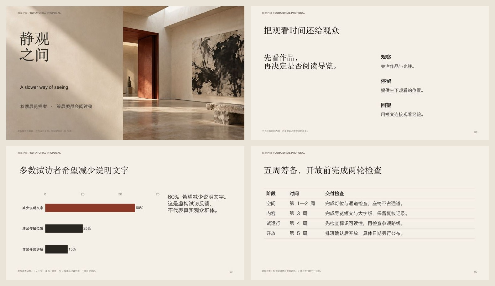
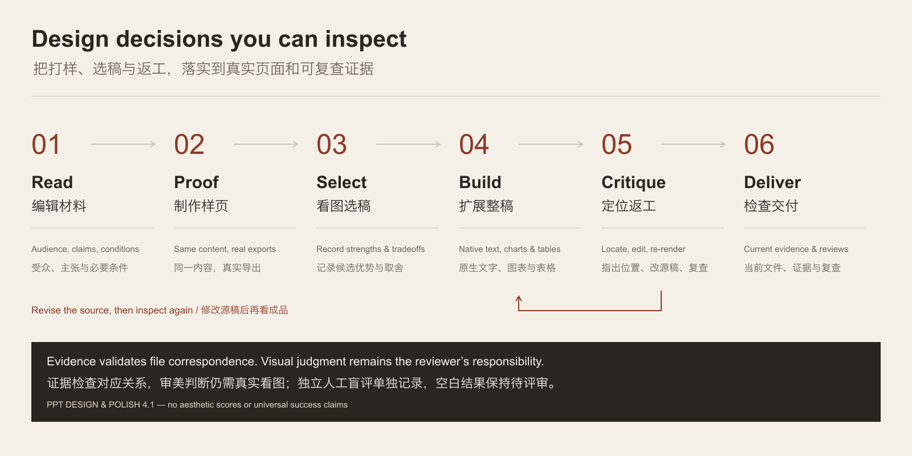

# PPT Design & Polish

**An open-source PowerPoint design skill for Codex and Claude Code. Turn material into editable slides through content editing, rendered proofs and visual revision.**

**面向 Codex 和 Claude Code 的开源 PPT 设计 skill。通过内容编辑、真实样页比较和看图返工，制作可编辑演示稿。**

[Install / 安装](#install--安装) · [Use / 使用](#use--使用) · [Examples / 实例](#examples--实例) · [Evidence / 验证](docs/EVALUATION.md) · [MIT](LICENSE)



## What's new in 4.1 / 4.1 的实际变化

The skill now records important design decisions against **real exported pages**. The included exhibition proposal demonstrates three proof comparisons and five located revisions, with editable PPTX, PDF and frozen evidence.

新版将关键设计判断绑定到**真实导出页面**。新增展览提案演示三种页面的打样比较与五项定位返工，附可编辑 PPTX、PDF 和可复查证据。

| Capability / 能力 | What happens / 实际执行 |
|---|---|
| **Read and edit / 阅读与编辑** | Preserve facts/conditions and establish the audience's reading task. / 保留事实与条件，明确页面要表达什么。 |
| **Proof and select / 打样与选稿** | Compare equal-content exports; record each candidate's strengths/tradeoffs. / 相同内容真实导出，记录候选优势与取舍。 |
| **Native composition / 原生编排** | Measured typography, deliberate color roles, configurable tables and charts. / 实际字体测量，明确配色职责，表格与图表按任务配置。 |
| **Visual revision / 看图返工** | Locate issues, edit source, re-export and bind fixes to changed page pixels. / 定位问题、改源稿、重新导出，修改记录对应新页面。 |
| **Honest evaluation / 如实验证** | Prepare anonymous reader pairs; blank feedback remains pending. / 提供匿名页面比较包，空白反馈保持待评审。 |



An approved reference can use one reference proof. Routine text edits stay small. The tools validate evidence correspondence; they do not certify beauty, perfect source understanding or invisible AI involvement. Independent human review of this release's example is **pending**.

已定参考可直接验证参考，简单改字保持简单。工具验证文件与记录的对应关系，不认证美感、完美理解或无法识别 AI 参与。本轮实例的独立人工评审仍为**待完成**。

## Install / 安装

Download the [portable skill ZIP / 便携安装包](https://github.com/bingxijun/ppt-design-polish/releases/latest/download/ppt-design-polish.zip), extract it and run the installer, or clone:

下载安装包后解压并安装，或克隆仓库：

```bash
git clone https://github.com/bingxijun/ppt-design-polish.git
cd ppt-design-polish
python3 scripts/install.py --client codex
# Claude Code: python3 scripts/install.py --client claude
# Update / 更新: add --update
```

The installer prints its destination and backs up updates. In the **installed directory**, run `npm install` if `doctor` cannot find PptxGenJS or `@napi-rs/canvas`. Refresh your client's skill discovery.

安装器打印目标目录，更新时备份旧版。若缺少构建或测量依赖，在**安装后的目录**运行 `npm install`，然后刷新客户端的 skill 发现。

Runtime: Python 3.9+, Node.js 22+, installed fonts. Final-file rendering needs LibreOffice + Poppler or a supported host renderer. Reasoning, image generation and visual inspection use the host agent. [Setup / 环境详情](docs/QUICKSTART.md).

## Use / 使用

Attach your material and a reference if available / 附上材料，有参考图一并附上：

```text
Use $ppt-design-polish to make this material into a presentation.
Infer the structure and a visual direction suited to the audience.
Follow the attached reference if present. Compare representative body,
data and difficult pages where useful, then refine the exported result.
Keep text, charts and tables editable. Deliver PPTX and PDF.
```

```text
使用 $ppt-design-polish，把这份材料做成 PPT。
按受众与内容安排结构，有参考图则遵循参考。
对重要正文、数据与困难页适当打样比较，再看图修改整稿。
文字、图表与表格可编辑，交付 PPTX 和 PDF。
```

In Claude Code use `/ppt-design-polish` or explicitly request the skill. Users need not choose layouts, write JSON or coordinate multiple skills. The agent chooses within the brief and keeps internal plans outside speaker notes.

Claude Code 可使用 `/ppt-design-polish` 或明确要求调用。用户无需选版、写 JSON 或调度多个 skill；agent 自主处理常规设计选择，内部计划不混入演讲备注。

## Examples / 实例

| Example / 实例 | Inspectable files / 可检查文件 |
|---|---|
| **静观之间 / Exhibition proposal · 6 pages** | [PPTX](examples/studio/exhibition.pptx) · [PDF](examples/studio/exhibition.pdf) · [Proofs, revisions and all pages / 打样、返工与全稿](examples/studio/README.md) |
| **AERIS ONE / Chinese launch · 10 pages** | [PPTX](examples/launch/launch.pptx) · [PDF](examples/launch/launch.pdf) · [Source / 来源](examples/launch/README.md) |
| **ATELIER NORTH / Studio brief · 5 pages** | [PPTX](examples/yellow/business.pptx) · [PDF](examples/yellow/business.pdf) · [Source / 来源](examples/yellow/README.md) |
| **Dispatch pilot / Operations review · 6 pages** | [PPTX](examples/operations/operations.pptx) · [PDF](examples/operations/operations.pdf) · [Source / 来源](examples/operations/README.md) |

The first example exercises 4.1's proof/revision workflow; the other examples retain their reviewed 4.0 exports. All identities/data are fictional. Generated imagery has saved prompts; key text/data remain native. Commercial reference screenshots, third-party keynote images and fonts are not redistributed.

首个实例验证新版流程，其他实例保留已检查的 4.0 导出稿。身份与数据均为虚构，生成图有提示词记录，关键文字与数据保持原生；不重分发商业模板截图、第三方发布会素材或字体。


[Earlier v3 → v4 comparisons / 早期版本对照](examples/evolution/README.md) use the same source and image assets, never a fabricated “without skill” baseline.

## Inside and limits / 实现与边界

`compose.py` checks evidence quotes, lexical numbers and source accounting, measures fonts and writes native objects. `studio.py` freezes proof exports, binds selections and tracks located visual fixes. `deck.py finalize` checks the current artifact/render/reviews and, for study-enabled workspaces, the current design evidence. `blind_review.py` prepares anonymous reader pairs and summarizes supplied decisions only.

编排器处理来源和实际测量；打样工具记录真实候选、取舍和定位修改；交付工具检查当前文件、渲染与复查；匿名评审工具只汇总实际填写的反馈。

The exhibition is an authored workflow demonstration, not a held-out test or completed independent designer review. Visible styling may reveal an anonymous pair's source, especially when the public example also shows its candidates. Strict blind evaluation needs separate unreleased material and independent readers. No universal quality rate is claimed.

展览实例是本次制作演示，不是封存测试或已完成的独立设计师评审。公开候选可能使匿名页面来源可被识别，严格盲评需另用未公开材料和独立读者；本项目不虚报通用成功率。

[Studio workflow / 打样接口](references/studio-workflow.md) · [Editorial decisions / 编辑判断](references/editorial-decisions.md) · [Composition API / 编排接口](references/composition-system.md) · [Evaluation status / 验证状态](docs/EVALUATION.md) · [Contributing / 参与贡献](CONTRIBUTING.md)

Independent MIT project. Methods informed by PPT Master, Baoyu slide-deck, PPTAgent and Presenton; precise reuse and licenses: [THIRD_PARTY_NOTICES.md](THIRD_PARTY_NOTICES.md). A single entry point does not imply feature parity with upstream applications.

独立 MIT 项目，吸收有效方法；实际复用和许可见第三方说明，单一入口不代表覆盖上游所有应用功能。
