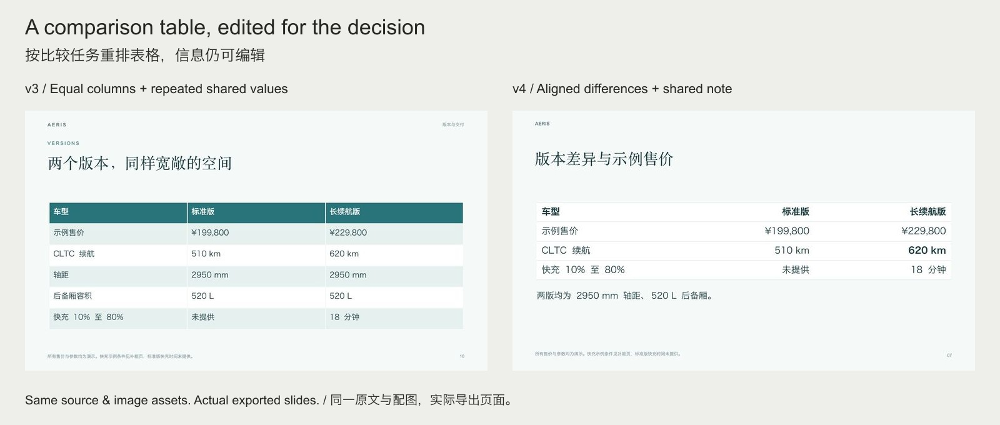
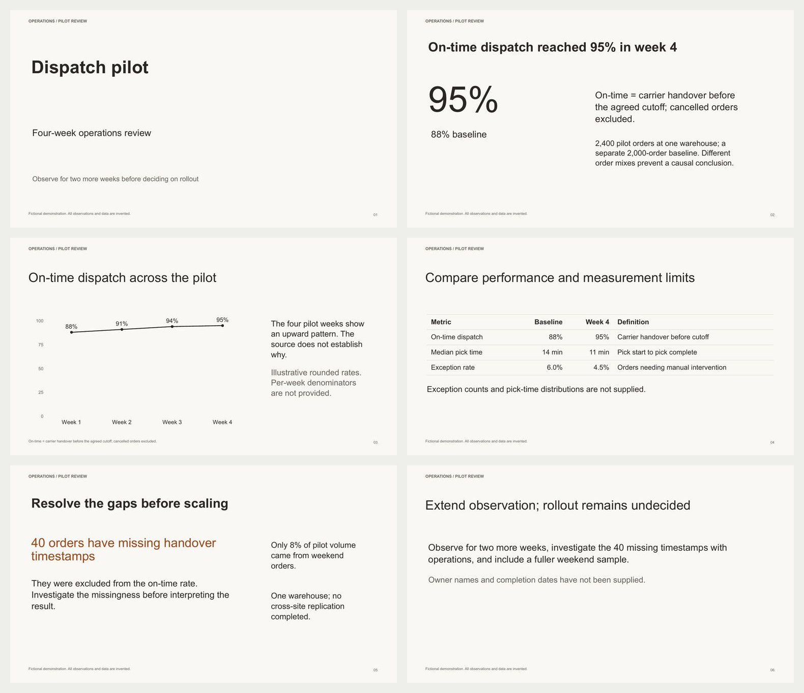

# PPT Design & Polish

**An open-source PowerPoint design skill for Codex and Claude Code. Content-led layouts, measured typography, editable charts and tables.**

**面向 Codex 和 Claude Code 的开源 PPT 设计 skill。按内容设计版式，实际测量文字，保留可编辑图表与表格。**

[Install / 安装](#install--安装) · [Use / 使用](#use--使用) · [Examples / 实例](#examples--实例) · [Design decisions / 设计原理](docs/DESIGN.md) · [MIT](LICENSE)



## What's changed in 4.0 / 4.0 改了什么

Our v3 engine itself encoded repetitive habits: equal text slots, uniform subheads, equal-width colored tables, automatic chart accents and industry-to-theme mapping. **4.0 changes those mechanics and the agent's editorial decisions.** A better image alone does not fix generic text or information hierarchy.

v3 编排器本身写入了等分内容、统一粗体小标题、等宽彩色表格、图表自动强调色和按行业套主题的惯性。**4.0 同时调整实际代码与 agent 的编辑判断。** 换一张漂亮配图解决不了文字和信息主次问题。

| Area / 环节 | Implemented change / 实际变化 |
|---|---|
| **Words / 文字** | Specific subjects and supported findings; optional subheads; measured paragraph flow instead of equal-height blocks. / 具体主题与有依据的结论，小标题按需使用，正文按实际高度流动。 |
| **Tables / 表格** | Content-based column widths, numeric alignment, measured rows, optional grouping and selective emphasis. / 按内容分配列宽，数字对齐，测量行高，分组与差异强调有依据。 |
| **Color / 颜色** | Palette derived from this brief/reference; explicit roles and reasons for focal data points. / 从本次材料或参考推导配色，焦点和状态有明确语义。 |
| **Composition / 编排** | Explicit reading relations or custom native frames. Teal/yellow remain optional recipes. / 指定表达关系或自定义原生构图，青绿与黄色保留为可选参考。 |
| **Review / 检查** | Contextual repetition diagnostics, final-export page review and stale-review protection. / 重复模式诊断、逐页实看成品，文件变动后旧验收失效。 |

This is design assistance, **not an AI detector or a promise that nobody can identify AI involvement**. The host still interprets the source and judges the export. The examples below are inspectable evidence, not a blinded aesthetic benchmark.

这是设计辅助，**不提供 AI 检测，也不保证任何人都识别不出制作工具**。理解原文和审美判断仍由宿主负责。下面给出可检查成品，不把内部验收包装成盲测排名。


## Install / 安装

Download the [portable skill ZIP / 便携安装包](https://github.com/bingxijun/ppt-design-polish/releases/latest/download/ppt-design-polish.zip), extract it and run the installer, or clone:

下载安装包后解压并安装，或克隆仓库：

```bash
git clone https://github.com/bingxijun/ppt-design-polish.git
cd ppt-design-polish
python3 scripts/install.py --client codex
# Claude Code: python3 scripts/install.py --client claude
# Update / 更新: add --update
```

The installer prints its destination and backs up updates. In the **installed directory**, run `npm install` if `doctor` cannot find PptxGenJS or `@napi-rs/canvas`. Refresh your client's skill discovery.

安装器打印目标目录，更新时备份旧版。若 `doctor` 找不到构建或测量依赖，在**安装后的目录**运行 `npm install`，然后刷新客户端的 skill 发现。

Runtime: Python 3.9+, Node.js 22+, installed fonts. Final-file rendering needs LibreOffice + Poppler or a supported host renderer. Reasoning and image tools come from the host agent. [Setup / 环境详情](docs/QUICKSTART.md).

## Use / 使用

Attach the announcement, a reference if available, and say / 附上材料，有参考图一并附上，直接说：

```text
Use $ppt-design-polish to make this material into a presentation.
Infer the page structure and a visual direction suited to the content.
Follow the attached reference if present. Keep text, charts and tables
editable. Review every exported page and deliver PPTX and PDF.
```

```text
使用 $ppt-design-polish，把这份材料做成 PPT。
根据内容安排页数、主次和设计，有参考图则遵循参考。
文字、图表和表格可编辑，实看全部导出页面后交付 PPTX 和 PDF。
```

In Claude Code use `/ppt-design-polish` or explicitly request the skill. Users need not choose layouts, write JSON, or coordinate multiple skills. Existing PPTX files can be polished with preservation-aware editing.

Claude Code 可使用 `/ppt-design-polish` 或明确要求调用。用户无需选择版式、写 JSON 或调度多个 skill；已有 PPTX 可走保留内容与原生对象的编辑路径。

## Examples / 实例

**Chinese product launch / 中文产品发布 · 10 pages**

Same fictional announcement and image assets as v3. Redundant navigation removed; concrete headlines, focused charging evidence, native chart and a comparison table that separates shared specifications.

沿用 v3 的虚构文告与配图，去掉多余导航，用具体标题呈现事实；充电页突出时长及条件，原生比较表区分共同参数与版本差异。


[PPTX](examples/launch/launch.pptx) · [PDF](examples/launch/launch.pdf) · [All pages and source / 全稿与来源](examples/launch/README.md)

**Architectural studio / 建筑工作室 · 5 pages**

White/yellow reference adapted to its subject: architecture, anchored material labels, portfolio comparison, process and a readable editorial paragraph. / 根据建筑主题使用白黄参考，包含照片标注、作品数量比较、服务流程与编辑式正文。


[PPTX](examples/yellow/business.pptx) · [PDF](examples/yellow/business.pdf) · [All pages and source / 全稿与来源](examples/yellow/README.md)

**Operations review / 运营复盘 · 6 pages**

A separate quantitative brief: typographic pages, a native line chart, a definition-rich table and one orange evidence-gap warning. No product-image requirement. / 独立的数据简报：文字层级、原生折线图、含指标定义的表格，仅用橙色强调待核查证据。



[PPTX](examples/operations/operations.pptx) · [PDF](examples/operations/operations.pdf) · [All pages and source / 全稿与来源](examples/operations/README.md)

All examples use fictional material. Product/studio images are original AI-generated assets with prompts; key text/data stay native. [v3 → v4 comparisons / 版本对照](examples/evolution/README.md) use actual exports, never a fabricated “without skill” baseline. Commercial reference screenshots, third-party keynote images and fonts are not redistributed.

## Inside / 实现与边界

The agent reads the whole source, edits claims and chooses the visual concept. `compose.py` checks evidence quotes, lexical numbers and paragraph accounting, then measures text and builds native objects. `design-audit.json` asks contextual questions about repetition; zero findings is not proof of originality. Render and inspect the final PPTX, not just source previews.

agent 通读原文、编辑事实并选择视觉表达；编排器检查来源、测量文字并建立原生对象。重复模式诊断只提供审查问题，零问题不等于原创性证明。实际验收必须看最终 PPTX 的渲染图。

[Editorial decisions / 编辑判断](references/editorial-decisions.md) · [Composition API / 编排接口](references/composition-system.md) · [Workflow / 进阶操作](docs/QUICKSTART.md) · [Contributing / 参与贡献](CONTRIBUTING.md)

Independent MIT project. Methods informed by PPT Master, Baoyu slide-deck, PPTAgent and Presenton; precise reuse and licenses: [THIRD_PARTY_NOTICES.md](THIRD_PARTY_NOTICES.md). One coordinated entry point does not imply feature parity with all upstream applications.

独立 MIT 项目，吸收各项目有效方法；具体复用与许可见第三方说明。单一入口不代表捆绑上游完整应用或覆盖它们的所有功能。
