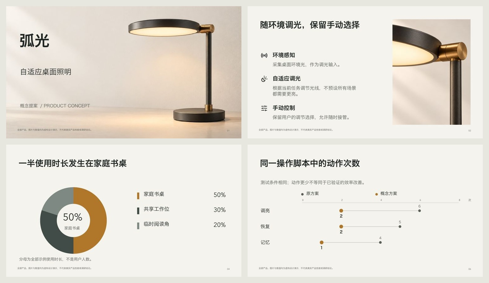
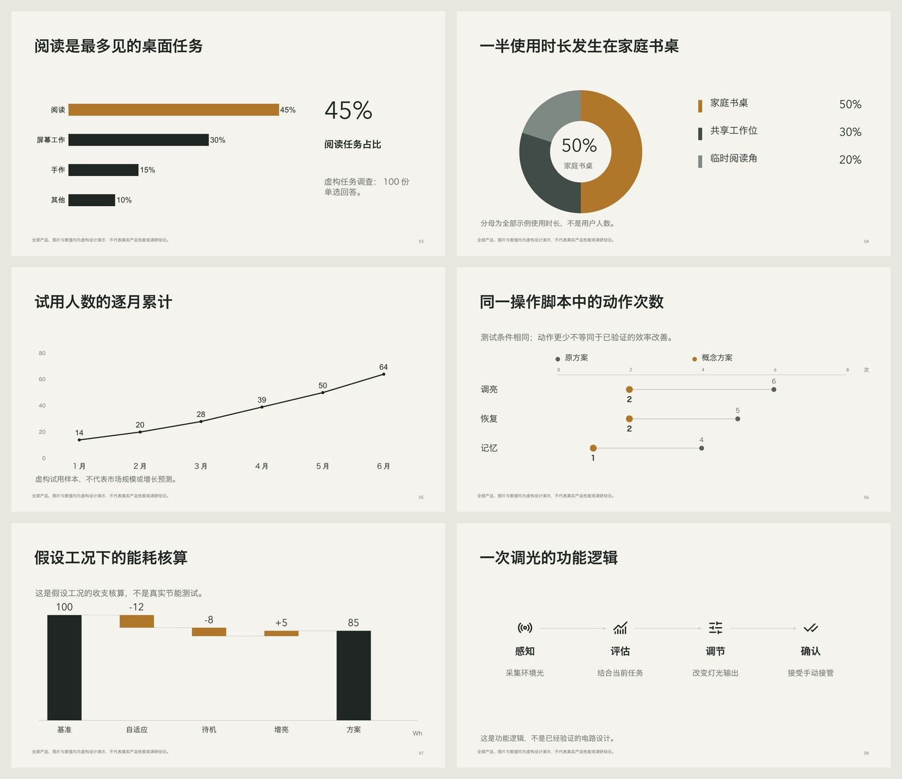
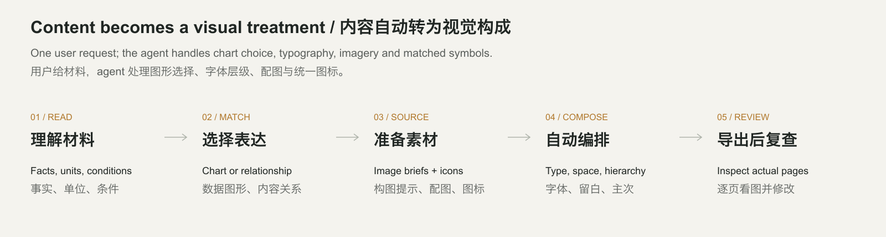

# PPT Design & Polish

**An open-source PowerPoint design skill for Codex and Claude Code. Turn material into editable slides with semantic charts, matched imagery, typography and visual revision.**

**面向 Codex 和 Claude Code 的开源 PPT 设计 skill。按内容自动安排图表、配图、字体与图标，并看图修改可编辑演示稿。**

[Install / 安装](#install--安装) · [Use / 使用](#use--使用) · [Examples / 实例](#examples--实例) · [Evidence / 验证](docs/EVALUATION.md) · [MIT](LICENSE)



## Visual defaults in 5.0 / 5.0 的默认视觉能力

The agent now turns a semantic content plan into **actual visual forms**, installed typography, consistent icons and executable image requests. The new example starts without font names or page coordinates. Its product photo, material close-up, analytical graphics and relationship diagrams are shown below.

新版把内容计划落实为**可执行的视觉表现**：自动匹配图形、已安装字体、统一图标，并形成和执行配图要求。新例子的原始计划不填写字体名称或页面坐标；产品主视觉、材质特写、分析图和关系图都来自实际导出。

| Material / 材料关系 | Default treatment / 默认表现 |
|---|---|
| Ranking / 类别排名 | Sorted horizontal bars, direct values and meaningful emphasis / 排序条形图、直接数值、重点突出 |
| Time / 时间变化 | Native line chart in source order / 按原始时间顺序绘制折线 |
| Share / 整体占比 | Doughnut plus directly labeled categories; check the denominator / 环形图与类别直标，先核对分母 |
| Before/after / 前后比较 | Editable dumbbell diagram with both endpoint values / 原生可编辑哑铃图，保留两组数值 |
| Contributions / 贡献拆解 | Reconciled waterfall diagram / 可核对加总的瀑布图 |
| Process, cycle, hierarchy / 流程、循环、结构 | Different relational geometry with matching semantic icons / 按真实关系编排，配同风格语义图标 |
| Product/features / 产品与功能 | Subject-specific hero, distinct detail image and measured explanations / 主视觉、独立细节图与有主次的功能说明 |



**24 pinned Lucide icons** are included with their licenses. They match covered concepts in Chinese/English, inherit a consistent ink and remain replaceable image assets. Unknown concepts get no arbitrary icon. Image requests specify framing, text-safe space and a shared visual language; the host executes its actual image/source tool. Writing a prompt alone does not count as producing an illustration.

随包提供 **24 枚已固定版本的 Lucide 授权图标**，按中英文含义匹配、统一墨色，作为可替换图片对象；未知概念不会乱配图标。配图要求自动带构图、文字留白和共同图像语言，由宿主实际执行生图或取图。原生正文、数值和数据图形保持可编辑；不把整页生成为图片。



Font defaults select installed CJK/Latin families and separate cover, headings, body and numerical readouts. Short final lines can rebalance by whole words. Explicit brand/template choices take priority. These are supported design starting points; complex specialist graphics still need a suitable backend or custom composition. [Recipe details / 配方与边界](references/visual-defaults.md).

默认按实际字体环境区分封面、标题、正文和大数字，尝试避免过短末行；品牌和指定模板优先。复杂专门图形仍应采用相应后端或自定义构图。4.1 的打样、选稿与看图返工流程继续保留，[独立人工审美评审仍待完成](docs/EVALUATION.md)。

## Install / 安装

Download the [portable skill ZIP / 便携安装包](https://github.com/bingxijun/ppt-design-polish/releases/latest/download/ppt-design-polish.zip), extract it and run the installer, or clone:

下载安装包后解压并安装，或克隆仓库：

```bash
git clone https://github.com/bingxijun/ppt-design-polish.git
cd ppt-design-polish
python3 scripts/install.py --client codex
# Claude Code: python3 scripts/install.py --client claude
# Update / 更新: add --update
```

The installer prints its destination and backs up updates. In the **installed directory**, run `npm install` if `doctor` cannot find PptxGenJS or `@napi-rs/canvas`. Refresh your client's skill discovery.

安装器打印目标目录，更新时备份旧版。若缺少构建或测量依赖，在**安装后的目录**运行 `npm install`，然后刷新客户端的 skill 发现。

Runtime: Python 3.9+, Node.js 22+, installed fonts. Final-file rendering needs LibreOffice + Poppler or a supported host renderer. Reasoning, image generation and visual inspection use the host agent. [Setup / 环境详情](docs/QUICKSTART.md).

## Use / 使用

Attach your material and a reference if available / 附上材料，有参考图一并附上：

```text
Use $ppt-design-polish to turn this material into a professional presentation.
Deliver editable PPTX and PDF.
```

```text
使用 $ppt-design-polish，根据这份材料制作一份专业 PPT，交付可编辑 PPTX 和 PDF。
```

The skill handles analytical forms, typography, imagery and useful icons by default. Add audience, brand or a reference when you have one; you do not need to list the design mechanics yourself.

分析图、字体层级、配图和必要图标属于默认能力，无需用户逐项提醒。有受众、品牌或参考图时一并提供即可。

In Claude Code use `/ppt-design-polish` or explicitly request the skill. Users need not choose layouts, write JSON or coordinate multiple skills. The agent chooses within the brief and keeps internal plans outside speaker notes.

Claude Code 可使用 `/ppt-design-polish` 或明确要求调用。用户无需选版、写 JSON 或调度多个 skill；agent 自主处理常规设计选择，内部计划不混入演讲备注。

## Examples / 实例

| Example / 实例 | Inspectable files / 可检查文件 |
|---|---|
| **弧光 / ARC visual defaults · 9 pages** | [PPTX](examples/visual-defaults/visual-defaults.pptx) · [PDF](examples/visual-defaults/visual-defaults.pdf) · [Source, prompts and all pages / 来源、提示词与全稿](examples/visual-defaults/README.md) |
| **静观之间 / Exhibition proposal · 6 pages** | [PPTX](examples/studio/exhibition.pptx) · [PDF](examples/studio/exhibition.pdf) · [Proofs, revisions and all pages / 打样、返工与全稿](examples/studio/README.md) |
| **AERIS ONE / Chinese launch · 10 pages** | [PPTX](examples/launch/launch.pptx) · [PDF](examples/launch/launch.pdf) · [Source / 来源](examples/launch/README.md) |
| **ATELIER NORTH / Studio brief · 5 pages** | [PPTX](examples/yellow/business.pptx) · [PDF](examples/yellow/business.pdf) · [Source / 来源](examples/yellow/README.md) |
| **Dispatch pilot / Operations review · 6 pages** | [PPTX](examples/operations/operations.pptx) · [PDF](examples/operations/operations.pdf) · [Source / 来源](examples/operations/README.md) |

The first example exercises 5.0's actual visual recipes; the exhibition retains its 4.1 evidence and the other examples retain their reviewed 4.0 exports. All identities/data are fictional. Generated imagery has saved prompts; key text/data remain native. Commercial reference screenshots, third-party keynote images and fonts are not redistributed.

首个实例验证 5.0 视觉配方；展览保留 4.1 证据，其他实例保留已检查的 4.0 导出稿。身份与数据均为虚构，生成图有提示词记录，关键文字与数据保持原生；不重分发商业模板截图、第三方发布会素材或字体。


[Earlier v3 → v4 comparisons / 早期版本对照](examples/evolution/README.md) use the same source and image assets, never a fabricated “without skill” baseline.

## Inside and limits / 实现与边界

`visuals.py` resolves visual recipes, installed typography, icons and image requests. `compose.py` checks evidence quotes, lexical numbers and source accounting, measures fonts and writes native objects. `studio.py` freezes proof exports, binds selections and tracks located visual fixes. `deck.py finalize` checks the current artifact/render/reviews and, for study-enabled workspaces, the current design evidence. `blind_review.py` prepares anonymous reader pairs and summarizes supplied decisions only.

视觉工具处理图形、字体、图标与配图要求；编排器处理来源和实际测量；打样工具记录真实候选、取舍和定位修改；交付工具检查当前文件、渲染与复查；匿名评审工具只汇总实际填写的反馈。

The exhibition is an authored workflow demonstration, not a held-out test or completed independent designer review. Visible styling may reveal an anonymous pair's source, especially when the public example also shows its candidates. Strict blind evaluation needs separate unreleased material and independent readers. No universal quality rate is claimed.

展览实例是本次制作演示，不是封存测试或已完成的独立设计师评审。公开候选可能使匿名页面来源可被识别，严格盲评需另用未公开材料和独立读者；本项目不虚报通用成功率。

[Visual recipes / 自动视觉配方](references/visual-defaults.md) · [Studio workflow / 打样接口](references/studio-workflow.md) · [Editorial decisions / 编辑判断](references/editorial-decisions.md) · [Composition API / 编排接口](references/composition-system.md) · [Evaluation status / 验证状态](docs/EVALUATION.md) · [Contributing / 参与贡献](CONTRIBUTING.md)

Independent MIT project. Methods informed by PPT Master, Baoyu slide-deck, PPTAgent and Presenton; precise reuse and licenses: [THIRD_PARTY_NOTICES.md](THIRD_PARTY_NOTICES.md). A single entry point does not imply feature parity with upstream applications.

独立 MIT 项目，吸收有效方法；实际复用和许可见第三方说明，单一入口不代表覆盖上游所有应用功能。
