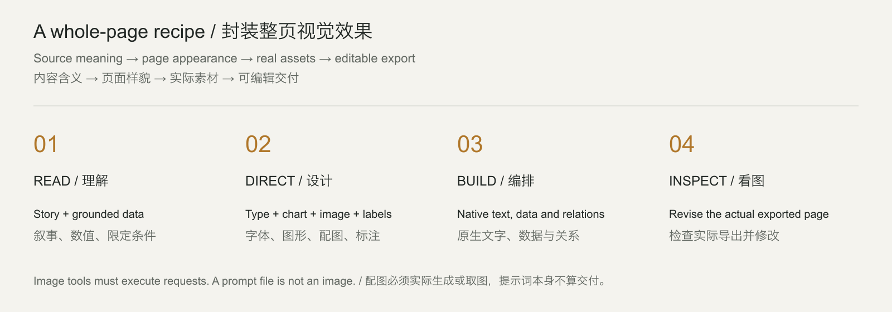
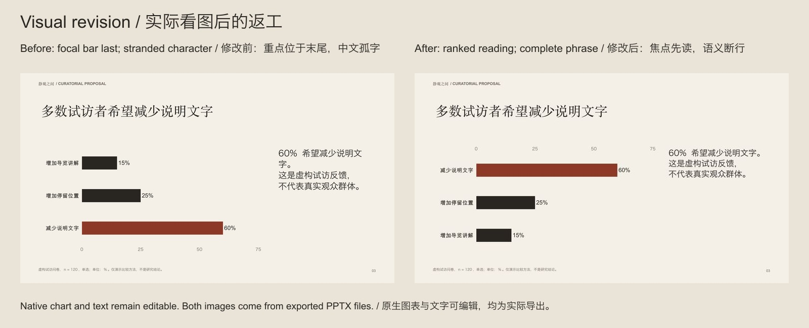

# PPT Design & Polish

**An open-source PowerPoint design skill for Codex and Claude Code. Turn material into editable slides with semantic charts, matched imagery, typography and visual revision.**

**面向 Codex 和 Claude Code 的开源 PPT 设计 skill。按内容自动安排图表、配图、字体与图标，并看图修改可编辑演示稿。**

[Install / 安装](#install--安装) · [Use / 使用](#use--使用) · [Examples / 实例](#examples--实例) · [Evidence / 验证](docs/EVALUATION.md) · [MIT](LICENSE)


## Whole-page defaults in 5.1 / 5.1 封装整页视觉效果

5.0 automated charts and icons, but its body pages still repeated a large heading over a single graphic. **5.1 adds complete page recipes:** display/body typography, image proportions, analytical composition, labels, surface contrast and functional details are arranged together.

5.0 虽然会配图表和图标，正文页仍反复“大标题加一个图形”。**5.1 把整页样貌封装进默认路径**：字体组合、图文比例、分析图、标注、背景层次与细节共同编排。

| Material / 材料 | Default appearance / 默认样貌 |
|---|---|
| Product features / 产品功能 | Tall material image + icon/text explanations; content-led dark surface / 材质特写、统一图标和完整说明，按内容使用深色页 |
| Ranking / 排名 | Sourced readout beside sorted native bars / 大数字读数与排序条形组成一页 |
| Share / 占比 | Finding + named whole, pie/ring, category/value ledger / 结论、分母、饼环图与类别数值账列 |
| Trend / 趋势 | Native line plot and final-period readout / 原生折线与末期读数 |
| Paired/contributions / 前后与拆解 | Matched-scale dumbbell or reconciled waterfall / 同刻度哑铃或可核对的瀑布图解 |
| Process/hierarchy / 流程与结构 | Numbered directional rail or actual parent-child connectors / 步骤编号、引导线，或真实父子结构 |

**Same source, data and two images.** Left: the published 5.0 export. Right: 5.1, with no font names or page coordinates in its high-level plan. This compares two versions of this skill; it is not a fabricated “without AI” example.

**相同材料、数据和两张配图。** 左侧为已发布的 5.0 导出稿，右侧为 5.1 自动处理；新计划没有填写字体名称或页面坐标。对照展示本项目两个版本，不伪造“未使用 AI”的基线。


`visual-brief.json` now records the complete appearance of every supported page. New semantic plans activate default treatment automatically. Building recompiles the current source plan, preventing old page geometry from silently surviving a content edit. Explicit brands, templates and reference designs take priority.

新增 `visual-brief.json` 封装每页完整生成描述；新语义计划默认启用视觉处理，构建自动重编当前计划，修复内容改了却继续输出旧页面的问题。品牌、模板和参考设计优先。



24 licensed Lucide icons match covered Chinese/English concepts and adapt to light/dark surfaces. Asset requests include subject, framing, text-safe space and shared visual language; the host must execute actual image tools. Native text and data remain editable. [Recipes and boundaries / 配方与边界](references/visual-defaults.md).

24 枚授权图标按中英文含义匹配并适配明暗背景；配图要求带主体、构图、文字留白与共同语言，由宿主实际生图或取图。文字和数据保持可编辑。独立人工审美评审仍待完成；完整页面示例比“美感评分”更值得检查。

## Install / 安装

Download the [portable skill ZIP / 便携安装包](https://github.com/bingxijun/ppt-design-polish/releases/latest/download/ppt-design-polish.zip), extract it and run the installer, or clone:

下载安装包后解压并安装，或克隆仓库：

```bash
git clone https://github.com/bingxijun/ppt-design-polish.git
cd ppt-design-polish
python3 scripts/install.py --client codex
# Claude Code: python3 scripts/install.py --client claude
# Update / 更新: add --update
```

The installer prints its destination and backs up updates. In the **installed directory**, run `npm install` if `doctor` cannot find PptxGenJS or `@napi-rs/canvas`. Refresh your client's skill discovery.

安装器打印目标目录，更新时备份旧版。若缺少构建或测量依赖，在**安装后的目录**运行 `npm install`，然后刷新客户端的 skill 发现。

Runtime: Python 3.9+, Node.js 22+, installed fonts. Final-file rendering needs LibreOffice + Poppler or a supported host renderer. Reasoning, image generation and visual inspection use the host agent. [Setup / 环境详情](docs/QUICKSTART.md).

## Use / 使用

Attach your material and a reference if available / 附上材料，有参考图一并附上：

```text
Use $ppt-design-polish to turn this material into a professional presentation.
Deliver editable PPTX and PDF.
```

```text
使用 $ppt-design-polish，根据这份材料制作一份专业 PPT，交付可编辑 PPTX 和 PDF。
```

The skill handles analytical forms, typography, imagery and useful icons by default. Add audience, brand or a reference when you have one; you do not need to list the design mechanics yourself.

分析图、字体层级、配图和必要图标属于默认能力，无需用户逐项提醒。有受众、品牌或参考图时一并提供即可。

In Claude Code use `/ppt-design-polish` or explicitly request the skill. Users need not choose layouts, write JSON or coordinate multiple skills. The agent chooses within the brief and keeps internal plans outside speaker notes.

Claude Code 可使用 `/ppt-design-polish` 或明确要求调用。用户无需选版、写 JSON 或调度多个 skill；agent 自主处理常规设计选择，内部计划不混入演讲备注。

## Examples / 实例

| Example / 实例 | Inspectable files / 可检查文件 |
|---|---|
| **弧光 / ARC 5.1 page recipes · 9 pages** | [PPTX](examples/launch-studio/launch-studio.pptx) · [PDF](examples/launch-studio/launch-studio.pdf) · [Same-input comparison and source / 同材料对照与源稿](examples/launch-studio/README.md) |
| **弧光 / ARC 5.0 baseline · 9 pages** | [PPTX](examples/visual-defaults/visual-defaults.pptx) · [PDF](examples/visual-defaults/visual-defaults.pdf) · [Source, prompts and all pages / 来源、提示词与全稿](examples/visual-defaults/README.md) |
| **静观之间 / Exhibition proposal · 6 pages** | [PPTX](examples/studio/exhibition.pptx) · [PDF](examples/studio/exhibition.pdf) · [Proofs, revisions and all pages / 打样、返工与全稿](examples/studio/README.md) |
| **AERIS ONE / Chinese launch · 10 pages** | [PPTX](examples/launch/launch.pptx) · [PDF](examples/launch/launch.pdf) · [Source / 来源](examples/launch/README.md) |
| **ATELIER NORTH / Studio brief · 5 pages** | [PPTX](examples/yellow/business.pptx) · [PDF](examples/yellow/business.pdf) · [Source / 来源](examples/yellow/README.md) |
| **Dispatch pilot / Operations review · 6 pages** | [PPTX](examples/operations/operations.pptx) · [PDF](examples/operations/operations.pdf) · [Source / 来源](examples/operations/README.md) |

The first example exercises 5.1 page recipes; the second preserves the 5.0 baseline; the exhibition retains its 4.1 evidence and the other examples retain their reviewed 4.0 exports. All identities/data are fictional. Generated imagery has saved prompts; key text/data remain native. Commercial reference screenshots, third-party keynote images and fonts are not redistributed.

首个实例展示 5.1 整页配方，第二个保留 5.0 对照；展览保留 4.1 证据，其他实例保留已检查的 4.0 导出稿。身份与数据均为虚构，生成图有提示词记录，关键文字与数据保持原生；不重分发商业模板截图、第三方发布会素材或字体。



[Earlier v3 → v4 comparisons / 早期版本对照](examples/evolution/README.md) use the same source and image assets, never a fabricated “without skill” baseline.

## Inside and limits / 实现与边界

`visuals.py` resolves visual recipes, installed typography, icons and image requests. `compose.py` checks evidence quotes, lexical numbers and source accounting, measures fonts and writes native objects. `studio.py` freezes proof exports, binds selections and tracks located visual fixes. `deck.py finalize` checks the current artifact/render/reviews and, for study-enabled workspaces, the current design evidence. `blind_review.py` prepares anonymous reader pairs and summarizes supplied decisions only.

视觉工具处理图形、字体、图标与配图要求；编排器处理来源和实际测量；打样工具记录真实候选、取舍和定位修改；交付工具检查当前文件、渲染与复查；匿名评审工具只汇总实际填写的反馈。

The exhibition is an authored workflow demonstration, not a held-out test or completed independent designer review. Visible styling may reveal an anonymous pair's source, especially when the public example also shows its candidates. Strict blind evaluation needs separate unreleased material and independent readers. No universal quality rate is claimed.

展览实例是本次制作演示，不是封存测试或已完成的独立设计师评审。公开候选可能使匿名页面来源可被识别，严格盲评需另用未公开材料和独立读者；本项目不虚报通用成功率。

[Visual recipes / 自动视觉配方](references/visual-defaults.md) · [Studio workflow / 打样接口](references/studio-workflow.md) · [Editorial decisions / 编辑判断](references/editorial-decisions.md) · [Composition API / 编排接口](references/composition-system.md) · [Evaluation status / 验证状态](docs/EVALUATION.md) · [Contributing / 参与贡献](CONTRIBUTING.md)

Independent MIT project. Methods informed by PPT Master, Baoyu slide-deck, PPTAgent and Presenton; precise reuse and licenses: [THIRD_PARTY_NOTICES.md](THIRD_PARTY_NOTICES.md). A single entry point does not imply feature parity with upstream applications.

独立 MIT 项目，吸收有效方法；实际复用和许可见第三方说明，单一入口不代表覆盖上游所有应用功能。
