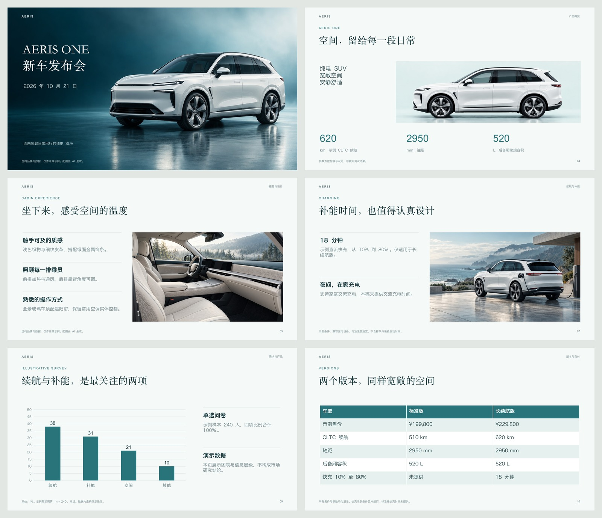
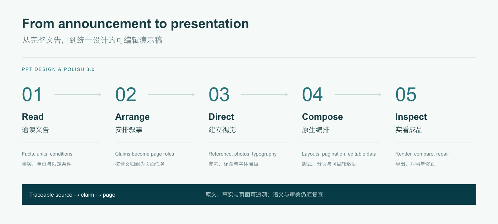
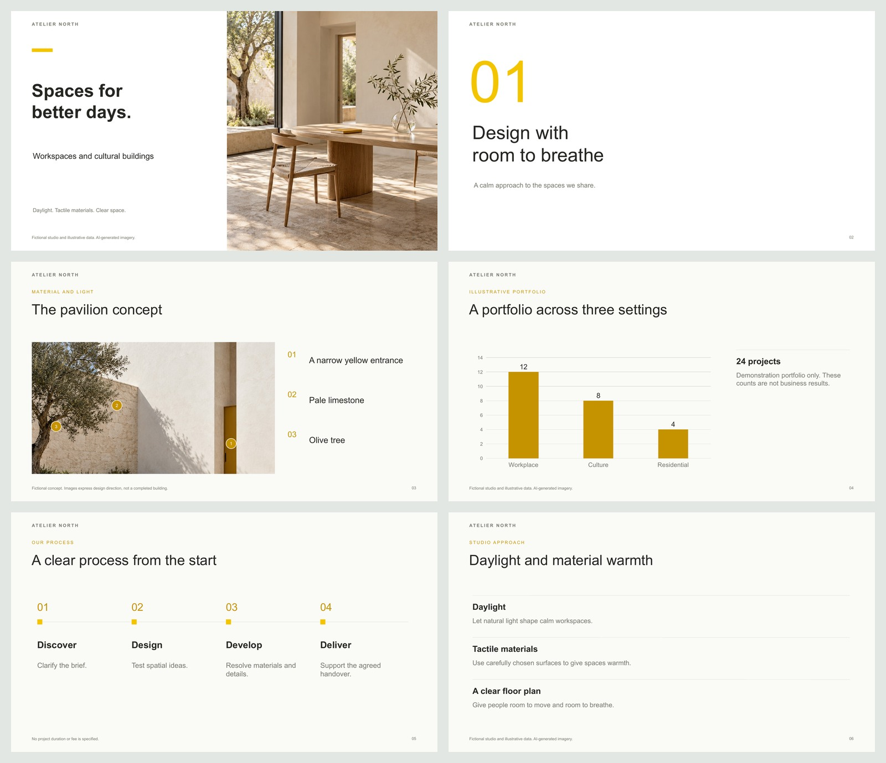

# PPT Design & Polish

**An open-source PowerPoint design skill for Codex and Claude Code. Turn an announcement into a coherent, editable presentation.**

**为 Codex 和 Claude Code 打造的开源 PPT 设计 skill。把发布文告编排成风格统一、正文完整、可编辑的演示稿。**

[Install / 安装](#install--安装) · [Use / 使用](#use--使用) · [Examples / 实例](#examples--实例) · [How it works / 原理](docs/DESIGN.md) · [MIT](LICENSE)



## What's new in 3.0 / 3.0 的实际变化

Previous versions offered design guidance but left the agent to invent layouts. **3.0 adds a working composition engine and two default design families**, demonstrated on complete content rather than cover studies.

此前版本提供审美建议，但版式仍由模型临时拼装。**3.0 新增可执行的编排器和两套默认版式系统**，用完整正文、图片、图表、版本比较和条件标注验证效果。

| Capability / 能力 | Result / 结果 |
|---|---|
| **Defaults with a visual identity / 有明确风格的默认值** | Teal product launches or white/yellow business decks. Typography, image ratios, spacing and labels work together. / 青绿发布会、白底黄标商务，统一字体、图像比例、间距和标注。 |
| **Read before arranging / 先理解，再编排** | The agent groups claims by meaning. The compiler selects layouts, splits overfull lists and accounts for source paragraphs. / agent 按含义归组，编排器选版、拆页并检查来源段落去向。 |
| **Purposeful imagery / 配图有职责** | Separate hero, overview, detail and context assets. Native text sits above image layers. / 主视觉、概览、细节与场景各司其职，文字独立可编辑。 |
| **Review the exported file / 实看最终文件** | Native charts/tables, image proportion checks, rendered page review and stale-review protection. / 原生图表与表格，修正图片比例，逐页复查并防止旧验收放行新稿。 |



## Install / 安装

Download the [portable skill ZIP / 便携安装包](https://github.com/bingxijun/ppt-design-polish/releases/latest/download/ppt-design-polish.zip), extract it, then run the installer below; or clone the repository:

下载并解压安装包后执行安装命令，或克隆仓库：

```bash
git clone https://github.com/bingxijun/ppt-design-polish.git
cd ppt-design-polish
python3 scripts/install.py --client codex
# Claude Code: python3 scripts/install.py --client claude
# Update / 更新: add --update
```

The installer prints the destination and keeps a backup on updates. If the host cannot find PptxGenJS, run `npm install` in that installed directory. Refresh the client's skill discovery.

安装器打印目标目录，更新会备份旧版。若环境找不到 PptxGenJS，在**安装后的目录**运行 `npm install`，然后刷新客户端的 skill 发现。

Runtime: Python 3.9+, Node.js 22+. Final-file rendering requires LibreOffice + Poppler or the host's supported artifact renderer. Reasoning and image generation use your host agent's tools. [Setup details / 环境详情](docs/QUICKSTART.md).

运行环境：Python 3.9+、Node.js 22+。成品渲染需要 LibreOffice + Poppler 或宿主支持的渲染器。推理和生图调用宿主已有工具。

## Use / 使用

Attach an announcement and say / 附上文告，直接说：

```text
Use $ppt-design-polish to turn this announcement into a presentation.
Choose the page structure and default design. Keep text, charts and tables
editable. Deliver PPTX and PDF after reviewing every exported page.
```

```text
使用 $ppt-design-polish，把这份发布文告做成 PPT。
自动理解内容、安排页数和版式，采用默认发布会风格，
文字、图表与表格保持可编辑，逐页检查后交付 PPTX 和 PDF。
```

In Claude Code use `/ppt-design-polish` or explicitly ask to use the skill. You do not need to choose layouts or write JSON. To follow a brand/reference, attach it; it overrides the defaults. For a business deck, say “white/yellow business style.”

Claude Code 可使用 `/ppt-design-polish`，或明确要求调用该 skill。用户无需选版或编写 JSON。有品牌或参考图时直接附上，优先遵循参考；商务稿可指定“白底黄标商务风格”。

## Examples / 实例

**Teal launch / 青绿产品发布：13 pages**, Chinese. Product hero, overview, cabin, range, charging, photo spread, native survey chart, version table, delivery timeline and warranty. / 包含真实正文、配图、数据和条件说明。

[Editable PPTX / 可编辑稿](examples/launch/launch.pptx) · [PDF](examples/launch/launch.pdf) · [Full preview and reproduction / 全稿预览与复现](examples/launch/README.md)

**Editorial yellow / 白底黄标商务：6 pages**, English. Architectural studio introduction, chapter, editable photo annotations, native portfolio chart and process timeline.



[Editable PPTX / 可编辑稿](examples/yellow/business.pptx) · [PDF](examples/yellow/business.pdf) · [Source and reproduction / 源文件与复现](examples/yellow/README.md)

Both examples use fictional brands/data and original AI-generated imagery. They show the shipped engine's output; they are not a blinded comparison against other tools. Commercial reference screenshots and third-party keynote assets are not redistributed.

两个实例均使用虚构品牌、演示数据和原创生成配图，展示本包实际输出，不是与其他工具的盲测对照；不分发商业模板截图或第三方发布会素材。

## Inside the skill / 实现内容

The host agent reads the whole announcement and writes a grounded semantic plan. `compose.py` checks quotes, lexical numbers, source-paragraph coverage and omitted claims, selects from **14 layout families**, and writes native slide objects. Existing native/template/image-first routes remain available.

宿主 agent 通读文告并生成语义计划。`compose.py` 检查引文、数字、段落覆盖与未呈现信息，从 **14 类版式**中编排可编辑对象；同时保留原生、模板修改和图片式路径。

Meaning, truth and visual quality still require the agent's judgment and final review. This skill does not guarantee perfect interpretation of arbitrary documents or supply an image model. Complex existing decks should use preservation-aware native editing. [Composition API / 编排接口](references/composition-system.md) · [Advanced workflow / 进阶流程](docs/QUICKSTART.md).

语义、事实与审美仍需 agent 判断和成品复查；skill 不承诺任意文档完美理解，也不自带图片模型。复杂原稿采用保留原生对象的编辑方式。

Independent MIT project. Methods informed by PPT Master, Baoyu slide-deck, PPTAgent and Presenton; actual reuse and licenses are documented in [THIRD_PARTY_NOTICES.md](THIRD_PARTY_NOTICES.md). [Integration map / 优势整合](docs/DESIGN.md) · [Contributing / 参与贡献](CONTRIBUTING.md).

独立 MIT 项目，吸收各项目的有效方法；实际复用内容与许可见第三方说明。原创图解和生成配图在适用范围内按相同许可提供；字体文件与第三方品牌素材不随包分发。
