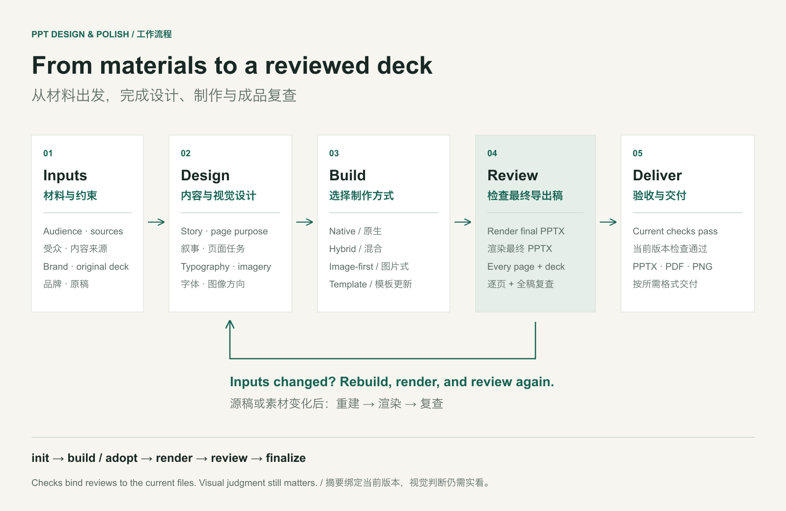
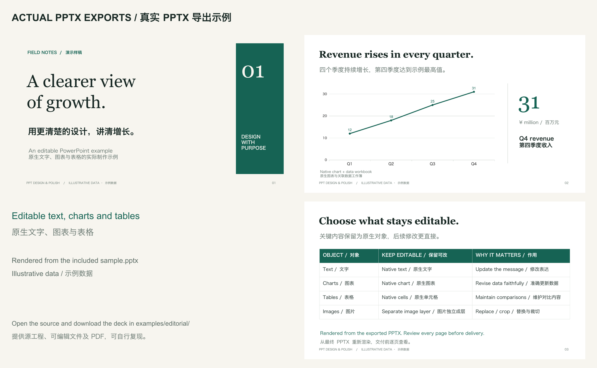
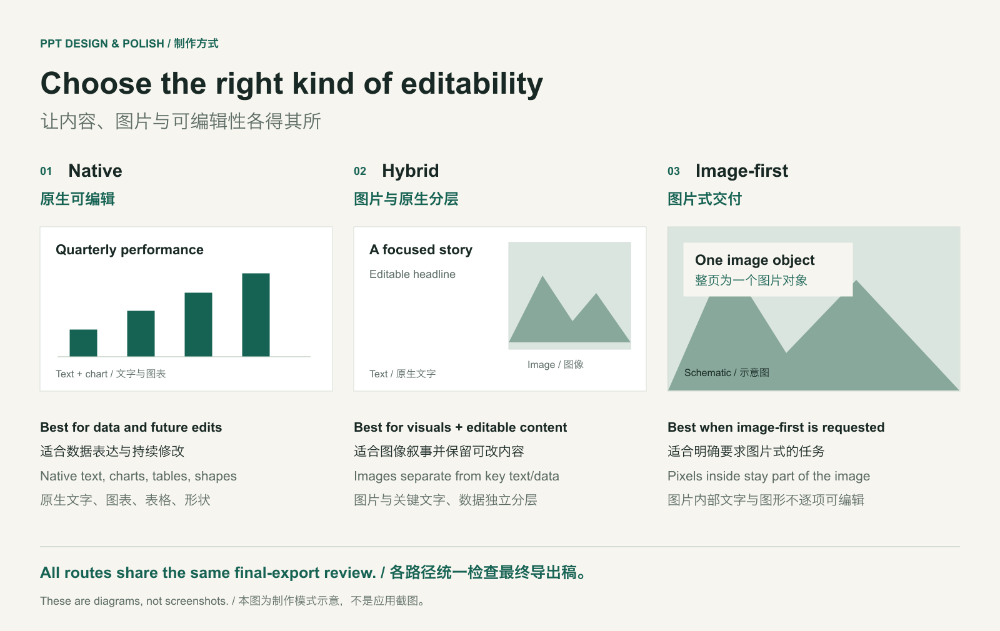

<p align="center">
  
</p>

# PPT Design & Polish

**An open-source PowerPoint skill for Codex and Claude Code. Create, redesign, and polish PPTX with purposeful visuals, editable content, and a review of the exported slides.**

**为 Codex 和 Claude Code 打造的开源 PPT 辅助 skill：统一完成创建、重设计与美化，让配图服务内容，保留可编辑元素，并复查最终导出的每一页。**

[Quick start / 快速使用](#quick-start--快速使用) · [Examples / 实例](#real-output--实际输出) · [Design rationale / 设计原理](docs/DESIGN.md) · [Advanced workflow / 进阶操作](docs/QUICKSTART.md) · [MIT](LICENSE)

## Why it helps / 核心优势

| Capability / 能力 | What you get / 带来的变化 |
|---|---|
| **Content-led design / 内容驱动设计** | Choose composition, typography, charts, and imagery around each slide's purpose. / 按每页任务决定版式、字体、图表与配图，减少机械套版。 |
| **One skill, several routes / 一个入口，多种路径** | Native, hybrid, image-first, template updates, or review-only. / 统一调度原生、混合、图片式、模板更新和只审查。 |
| **Editable by intent / 按需保留可编辑性** | Native text, charts, tables, and shapes; images remain separate layers. / 关键文字、数据与图解保留为原生对象，图片独立成层。 |
| **Review the actual export / 检查真实成品** | Render the exported PPTX and inspect every slide and the whole deck. / 从导出的 PPTX 重新渲染，逐页与全稿复查。 |
| **Changes invalidate old reviews / 改动后重新验收** | File fingerprints prevent outdated review records from approving a changed deck. / 文件摘要将验收绑定到当前版本，避免旧记录放行新稿。 |



The skill combines agent guidance with working Python/Node tools. Your host agent provides reasoning, image generation, and any connected apps. The skill itself does not bundle an image model or a cloud service.

本项目由 skill 指令和可执行 Python/Node 工具组成。推理、生图及连接应用来自宿主 agent；项目本身不附带图片模型或云服务。

## Quick start / 快速使用

### 1. Install / 安装

Requirements: **Python 3.9+**, **Node.js 22+**, and npm for the bundled editable-slide builder. / 本包的可编辑制作后端需要 **Python 3.9+、Node.js 22+ 和 npm**。

```bash
git clone https://github.com/bingxijun/ppt-design-polish.git
cd ppt-design-polish

# Choose one / 选择一个客户端
python3 scripts/install.py --client codex
# python3 scripts/install.py --client claude
```

The installer prints the installed directory. Run `npm install` **there** if PptxGenJS is unavailable, then restart the client or refresh its skill discovery. It never overwrites an existing skill unless you pass `--update`; updates keep a backup.

安装器会打印安装目录。若环境缺少 PptxGenJS，在**该目录中**运行 `npm install`，然后重启客户端或刷新 skill 发现。已有同名 skill 默认不覆盖；显式 `--update` 更新时保留备份。

For example, with default paths / 默认路径示例：

```bash
# Codex
cd ~/.codex/skills/ppt-design-polish
npm install
python3 scripts/deck.py doctor

# Claude Code: use ~/.claude/skills/ppt-design-polish instead
```

For full export-and-review support, install **LibreOffice + Poppler** (`soffice`/`libreoffice` and `pdftoppm` on PATH). A host-provided artifact renderer is another supported option. Image generation is optional and uses the host's available tools.

完整的导出复查需要 **LibreOffice + Poppler**，或宿主已提供的 artifact 渲染器。生图为可选能力，调用宿主现有工具。详见[环境与命令 / setup and commands](docs/QUICKSTART.md)。

### 2. Ask naturally / 直接描述任务

In Codex, invoke `$ppt-design-polish`. In Claude Code, invoke `/ppt-design-polish` or ask it to use the installed skill.

Codex 使用 `$ppt-design-polish`；Claude Code 使用 `/ppt-design-polish`，也可明确要求调用已安装的 skill。

```text
Use $ppt-design-polish to create an 8-slide investor presentation from
these materials. Keep financial charts editable, follow our brand,
and deliver PPTX plus PDF. Review every exported slide before delivery.
```

```text
使用 $ppt-design-polish 美化这份 PPT。保留原有事实、数据和页数，
采用适合管理层阅读的专业风格，关键文字和图表保持可编辑。
配图需要帮助解释内容，交付 PPTX 和 PDF，并逐页检查最终导出效果。
```

Attach your materials or existing deck. Add audience, brand/reference, language, and desired output when relevant. The skill selects the internal route; you do not need to invoke several PPT skills.

提供材料或原稿，按需补充受众、品牌参考、语言与输出格式。skill 自动选择内部制作路径，无需轮流调用多套 PPT skills。

## Real output / 实际输出



These are rendered pages from the included editable sample, using illustrative data. They demonstrate this repository's builder, not a benchmark against other tools. The hero at the top is a generated concept illustration.

以上为仓库内可编辑示例的实际导出页面，数据仅用于演示；不是与其他工具的效果对照测试。页首主视觉为 AI 生成的项目概念配图。

[Download the editable PPTX / 下载可编辑 PPTX](examples/editorial/sample.pptx) · [View PDF / 查看 PDF](examples/editorial/sample.pdf) · [Source and reproduction / 源文件与复现](examples/editorial/README.md)

## Choose the right route / 按任务选择制作方式



| Task / 任务 | Route / 路径 |
|---|---|
| New business, research, or teaching deck / 新建商业、研究或教学稿 | Native editable objects with optional image layers / 原生对象，按需叠加图片 |
| Visual storytelling / 视觉叙事 | Hybrid or explicitly requested image-first slides / 混合制作，或按明确需求采用图片式 |
| Existing branded deck / 已有品牌稿 | Inspect and render first; use native editing or scoped text patches / 先清点和渲染，再原生编辑或局部改字 |
| Export from another tool / 接入其他工具的导出稿 | `adopt` the PPTX, then use the same review workflow / `adopt` 接入 PPTX，统一复查 |
| Design feedback only / 只要评审建议 | Render and report slide-specific findings / 渲染后按页指出具体问题 |

## What is included / 功能与边界

- **Working tools / 可执行工具：** JSON → PPTX; theme/layout/media extraction; text-run patching; content/object checks; rendering; version-bound review records; checked delivery.
- **Design guidance / 设计方法：** narrative, typography, layout, chart choice, image direction, brand reuse, and slide-by-slide review.
- **Supported delivery / 支持交付：** PPTX, rendered PNG, and PDF through the LibreOffice path. Font and target-application differences still require inspection.
- **Scope / 范围：** focused text patches preserve other ZIP-part payloads; arbitrary lossless PPTX rebuilding, all SmartArt/animation features, narration, and video are not implemented.
- **Quality / 质量：** automated checks verify structure and review freshness. They cannot prove good taste, factual accuracy, or that someone actually looked at an image. We do not promise “zero AI look.”

工具覆盖原生制作、主题和素材提取、局部改字、内容约束、渲染与版本绑定验收；设计指令覆盖叙事、排版、图表、配图和品牌复用。支持 PPTX、PNG，以及 LibreOffice 路径生成的 PDF。

局部文字补丁会保留其他 ZIP 部件的内容，但不支持任意稿件的无损重建，也未实现全部 SmartArt、动画、配音或视频功能。自动检查不能证明审美、事实准确性或图片确实被查看，也不承诺“零 AI 味”。

## Origins and contribution / 来源与参与

An independent project that combines useful methods from PPT Master, Baoyu's slide-deck workflow, PPTAgent, and Presenton. Most tools are implemented here; a small PPTAgent review validator is reused under MIT. This is not a redistribution of those complete products.

这是独立项目：吸收 PPT Master、宝玉 slide-deck、PPTAgent、Presenton 各自的方法优势；主要工具由本项目实现，一小段 PPTAgent 验收校验代码按 MIT 复用，不打包分发上述完整产品。

[Integration map / 优势整合与设计分析](docs/DESIGN.md) · [Third-party notices / 第三方说明](THIRD_PARTY_NOTICES.md) · [Contributing / 参与贡献](CONTRIBUTING.md)

**License / 许可：** original code and documentation are [MIT](LICENSE). Third-party components retain their licenses. Project-created diagrams and the generated hero are included under the same permission grant to the extent applicable; no third-party brands or fonts are bundled.

原创代码与文档采用 MIT，第三方组件保留原许可。原创图解及生成主视觉在适用范围内按相同条款授权；不附带第三方商标或字体文件。
