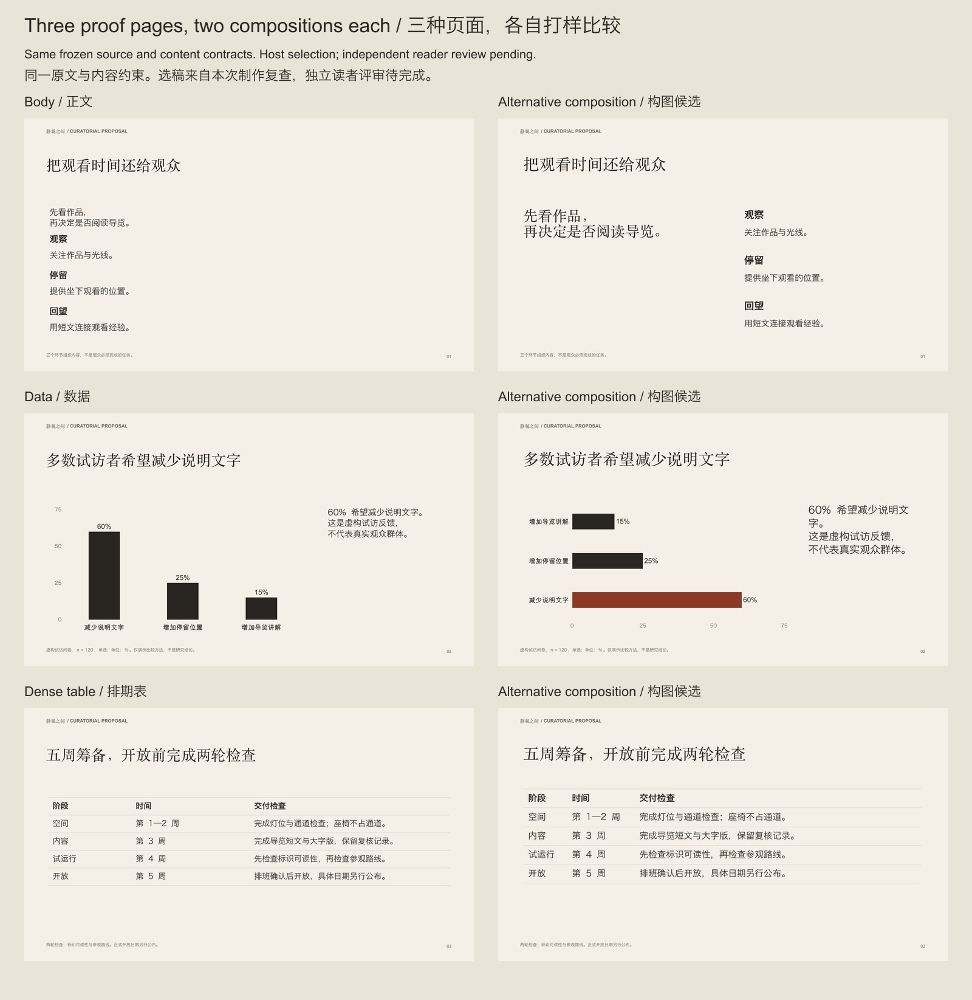

# What was checked / 实际验证了什么

**Release 5.0 has no completed independent human preference result.** The anonymous reader packet is prepared, its CSV is blank, and [reader-status.json](../examples/studio/reader-status.json) records `pending` with zero decisions. Automated tests and host selections are reported separately.

**本版尚无完成的独立人工偏好结果。** 匿名评审包已准备，CSV 空白，状态为待评审、零条反馈。脚本检查与制作方选稿不冒充人工盲评。

## 5.0 visual recipe check / 5.0 视觉配方验证

[ARC / 弧光](../examples/visual-defaults/README.md) is a fictional nine-page product concept. Its high-level plan declares source claims and analytical/relational intents, without page coordinates or font names. The engine selects installed typography, matches six distinct icons from the 24-icon licensed library, and produces image requests; the host used built-in imagegen for the hero and a separate identity-matched material detail. Both actual prompts are saved.

九页原稿计划不填写页面坐标或字体名称。引擎按内容关系编排图形、选择实际字体并匹配六种图标；宿主实际生成了主视觉与保持同一产品外观的材质特写，保留完整提示词。

The exported PPTX contains three native workbook charts (ranking, share, time), native shape/text dumbbell and waterfall diagrams, and editable process/hierarchy connectors. Required content and chart/table contracts are checked. These different object types are reported separately; icons/photos remain replaceable images.

导出稿区分三张带工作簿的原生图表与形状/文字组成的哑铃、瀑布图解；流程和结构连接线也可编辑，配图与图标为可替换图片。

Visual inspection found an overlapping subtitle/legend and hierarchy lines too close to labels/icons. The recipe coordinates were corrected and the full deck rendered again. Regression tests also cover denominator reconciliation, honest scales, matched pairs, contribution totals, font selection, icon omission, real-product image restrictions, hierarchy cycles and short-line rebalancing. **Passing these tests is not a beauty score.** The nine-page example is an authored functional demonstration, not an independent quality comparison.

看图发现并修复了图例与副标题重叠、结构线靠近文字/图标的问题。测试检验数据和实际输出行为，不给美感打分；本例仍是制作方编写的功能演示。

## 4.1 evidence retained / 保留的 4.1 证据

## New material / 新材料

[静观之间](../examples/studio/README.md) is a newly authored fictional curatorial brief, with a frozen [source](../examples/studio/inputs/announcement.md) and [source index](../examples/studio/source.json). It covers a viewing premise, optional stages, a three-category questionnaire, a conceptual route, five preparation weeks, accessibility/service limits and a committee decision. It is **not** a held-out brief unseen by the author.

新例题以展览阅读提案检验跨主题流程，包含正文、数据、动线与排期；材料由本次制作方撰写，不能称为生成方未见过的封存测试。

## Proof comparisons / 打样比较

Three page jobs each have two actual exported candidates. They share frozen raw inputs, text contracts and chart values. One uses standard composition recipes, the other deliberately authors different hierarchy, labels or table proportions. They are from the same host agent, not different models or independent designers. The existing recipe is allowed to win; this example's selections are contextual host decisions.

三种任务各有两个实际导出候选，原文和内容约束一致。比较的是本次构图取舍，不是模型排名；原方案可以被选中，本例的选择不代表普遍优越性。

Frozen PPTX, page images and source JSON are under [evidence/candidates](../examples/studio/evidence/candidates). Selection observations are in [evidence/index.json](../examples/studio/evidence/index.json). The page-content signature is a traceability guard, not semantic-equivalence proof.

## Observed revision / 实际返工

Inspecting the first full export exposed five concrete issues, preserved in [round 01](../examples/studio/evidence/rounds/01):

| Issue / 问题 | Source change and verification / 修改与复查 |
|---|---|
| Full-bleed image covered disclosure / 全幅图遮住说明 | Native furniture is now painted after freeform frames; the cover disclosure is visible. / 调整原生绘制顺序，封面说明已可见。 |
| Focal horizontal bar appeared last / 重点条形位于末尾 | Explicit first-at-top category order; original values and zero baseline retained. / 支持明确类别顺序，保留数值与零基线。 |
| Dangling Chinese character / 中文孤字 | Commentary width/type adjusted; the first sentence stays together. / 调整文字框与字号，语义完整。 |
| Route rules lacked direction / 动线方向不明 | Native directed connectors link actual stages. / 原生箭头连接三个真实阶段。 |
| Limitation split across a term / 限制说明断词 | Phrase breaks and width corrected; no qualifiers removed. / 语义断行，保留全部限制。 |

The revised six-page PPTX was rendered and each page inspected against the complete source. [Review](../examples/studio/review.json), [delivery checks](../examples/studio/validation.json) and [portable evidence report](../examples/studio/evidence/report.json) are available. Native chart/table content and frozen file hashes are checked in CI. A reported fix requires a changed export and changed affected-page pixels; that condition alone cannot establish that a change is good.

修正版逐页对照原文检查，附记录与文件摘要。修改页像素变化是可复查的必要条件之一，仍不能单凭变化证明修改更好。

## Independent review protocol / 独立评审方法

The [reader packet](../examples/studio/reader-pack/index.html) contains anonymous left/right images and [ratings.csv](../examples/studio/reader-pack/ratings.csv). Download the folder to open the HTML locally. Compare at readable size against each case's stated audience/viewing/page task. Enter a reviewer code, left/right/tie/unjudgeable per criterion, and concrete observations. The decoding key is kept outside the public repository. No reviewers have been contacted or votes fabricated.

下载评审包文件夹后，本地打开 HTML 并放大查看，按任务比较可读性、主次、文字与颜色；解码表不公开，也没有代填意见或联系他人。

Because this public example also publishes its candidate pages, it is a tool demonstration rather than a strict blind experiment. A genuine future evaluation needs separately held-out briefs, readers who did not author the slides, identical source/assets/time constraints, and a recorded protocol. Report case/reviewer counts, disagreement, ties and unjudgeable results. Descriptive preference counts are not a population-wide success rate; repeated pages from one brief are not independent trials.

公开候选可能暴露条件，严格盲评应另用封存材料与独立评审。固定输入、素材、时间和协议；报告人数、题目数、分歧与无法判断情况，不把同一题多页当成独立样本，不虚构“百分百”。
