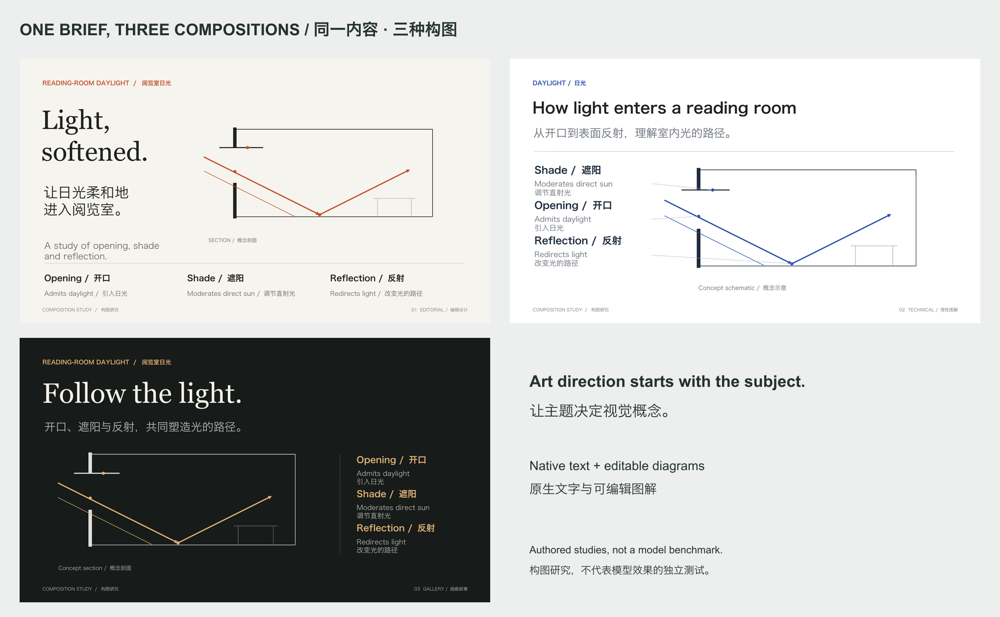

> Legacy runtime/design fixture. Current default design examples: [launch](../launch/README.md) and [business](../yellow/README.md).
> 旧版运行或构图示例；当前默认效果请看发布会与商务实例。

# One brief, three compositions / 同一内容，三种构图

An educational page about how an opening, shade, and reflection shape daylight in a reading room. All three alternatives retain the same concepts in English and Chinese. Text and section diagrams are native editable PowerPoint objects.

主题为阅览室中开口、遮阳与反射对日光的作用。三个方案保留相同概念及中英文说明，文字和剖面图解均为原生可编辑对象。

| Direction / 方向 | Composition / 构图 | Tradeoff / 取舍 |
|---|---|---|
| Editorial / 编辑设计 | Large type beside a generous drawing; definitions on a shared baseline. / 大字与图解对置，定义共用基线。 | Suits a calm teaching or editorial page; peripheral captions are smaller. / 适合安静的教学或编辑表达，辅助文字相对小。 |
| Technical / 理性图解 | Annotation column linked to actual diagram features. / 定义列与图解部位直接连线。 | Makes relationships explicit; stronger annotation density. / 关系明确，标注密度较高。 |
| Gallery / 画廊叙事 | A large headline and luminous diagram on a dark field. / 大标题配暗底亮色图解。 | Emphasizes the light path; dark backgrounds may be unsuitable for some brands or print workflows. / 光的路径突出，暗底需符合品牌及打印用途。 |

[Editable PPTX / 可编辑文件](studies.pptx) · [PDF](studies.pdf) · [Source / 源工程](deck.json) · [Design decisions / 设计记录](design-plan.json)

These are authored alternatives for **one body page**, not consecutive pages of one recommended deck. They demonstrate feasible compositions and the new design process; they are not an independent test of model behavior or proof of superiority over another tool. Pick one direction and develop the remaining pages with its rules. A full project must also prove the direction on its difficult content.

这是**同一正文页**的不同构图方案，并非建议混用为一份整稿的连续页面。它们展示可实现的构图及新版设计流程，不是独立模型行为测试，也不证明优于其他工具。正式项目需选择合适方向，按其规则扩展，并验证困难内容页。

The section is a concept schematic, not an engineering simulation. Fonts are Georgia and Hiragino Sans GB in the verified macOS render; substitute installed equivalents on other systems. No font files are bundled. The exported PPTX was rendered through LibreOffice and inspected page by page; Microsoft PowerPoint itself was not tested.

剖面为概念示意，不是工程模拟。已验证的 macOS 渲染使用 Georgia 与 Hiragino Sans GB；其他系统可替换为已安装字体，不分发字体文件。PPTX 经 LibreOffice 重新渲染并逐页检查，尚未验证 PowerPoint 本体。

Reproduce using [the workflow commands](../../docs/QUICKSTART.md#reproduce-the-sample--复现示例), substituting this directory's JSON sources and a three-slide workspace. The review file must reflect actual inspection of your export.

按进阶说明的命令复现，使用本目录 JSON 和三页工作区；复查记录需对应实际查看的新导出稿。
