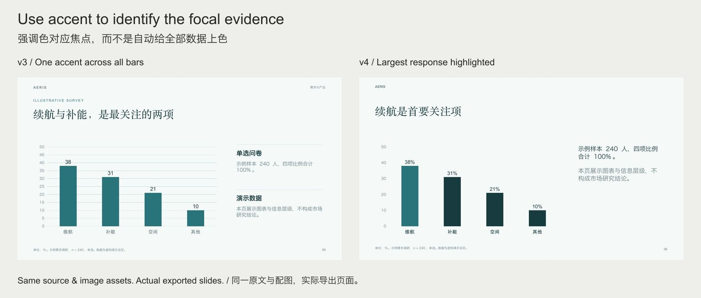
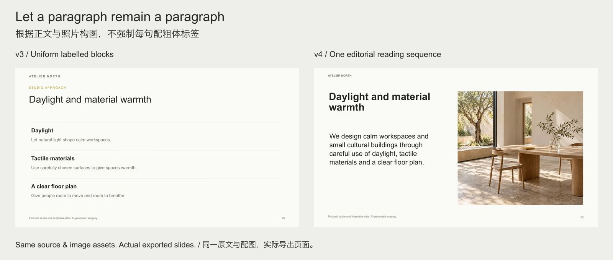

# v3 → v4 / 相同材料的版本对照

These are **actual v3 and v4 exported slides**, using the same fictional announcements and existing image assets. v3 originals are frozen under `before/`; complete older source/exports remain in [tag v3.0.0](https://github.com/bingxijun/ppt-design-polish/tree/v3.0.0/examples). This is not a fabricated “without skill” baseline or a blinded trial.

下面是相同虚构原文与已有图片的真实版本对照。旧页面固化在 `before/`，旧版完整源稿与成品保留在标签中；不冒充“未使用 skill”的对照，也不宣称盲测结论。

Rows now emphasize version differences; shared dimensions appear beneath. Numeric columns align right, widths follow the task, and the header is quiet. Text remains editable. / 比较行呈现版本差异，共同尺寸移到表旁；数字右对齐，列宽服从任务，表头不自动着色。

Only the largest survey response is accented, with its reasoning stored in the plan. Other categories remain comparison context. / 仅突出最大关注项，理由保存在计划中，其他类别作为比较背景。

A source paragraph becomes an editorial reading sequence with the existing architectural photo. Not every sentence is turned into a labelled block. / 原文段落按阅读顺序与已有建筑照片构图，不把每句都拆成统一小标题块。

Different content may justify filled headers, equal columns or repeated layouts. v4 supplies controls and contextual review, not a prohibition list or a new universal template. / 其他内容可能适合色块表头、等宽列或重复版式；新版提供判断与控制，不把反套路变成新的万能模板。
