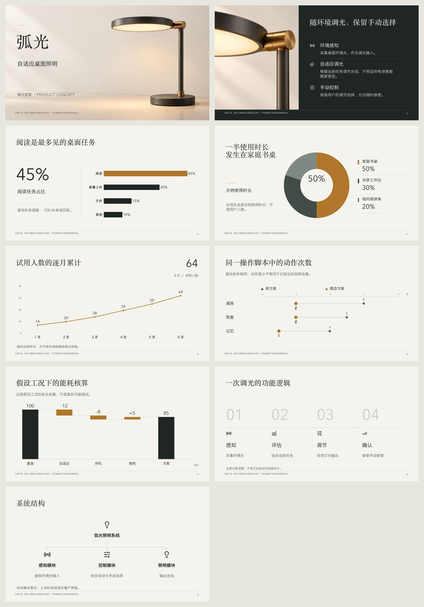

# ARC / 弧光 — 5.1 whole-page defaults

Same fictional source, claims, data and the exact two image files as the [published 5.0 example](../visual-defaults/README.md). Only the automatic visual treatment changes. The new [plan](plan.json) contains no font names, page coordinates or manually chosen page recipes. Product illustration briefs select the product-launch direction.

与 5.0 使用相同的虚构材料、内容、数值和两张原图，只改变自动视觉处理。高层计划不填写字体名称、坐标或逐页配方，由产品配图需求自动选择发布方向。

[Editable PPTX / 可编辑稿](launch-studio.pptx) · [PDF](launch-studio.pdf) · [Complete appearance descriptions / 完整视觉描述](visual-brief.json) · [Source](announcement.md) · [Image provenance / 图片提示词](prompts.json) · [Review / 实际复查](review.json) · [Delivery checks / 交付检查](validation.json)


- **Type / 字体：** installed serif display, sans descriptions and distinct numeric readouts / 实际安装的衬线标题、无衬线正文和数字字体。
- **Features / 功能：** large material image, dark surface, white semantic icons and measured rows / 大材质图、深色底、白色语义图标与完整说明。
- **Analysis / 分析：** different ranking, share, trend, paired and contribution compositions; source qualifications stay visible / 根据关系匹配构图，保留条件。
- **Process / 流程：** large ordinals plus directional rail and small consistent symbols / 大编号、引导线与同风格小图标。



Three native charts retain workbook data; paired/waterfall and relationship diagrams retain editable native shapes, text and connectors. Images and icons are replaceable raster assets. All identities and figures are fictional. The same previously generated imagery is reused, so this is a layout comparison rather than a claim that a new image model improved the result.

三张原生图表保留工作簿；其他图解保留原生对象。照片与图标为可替换位图，所有身份和数值均为虚构。本轮复用已有配图，避免把换图带来的效果误当作排版改进。

## Reproduce / 复现

Copy `plan.json`, `source.json`, `inputs/` and `assets/` into a fresh workspace. Run from the repository root; `build` prepares icons and recompiles the plan automatically.

复制这些文件到新工作区后运行，构建会自动准备图标并重编当前计划：

```bash
python3 scripts/deck.py --workspace /absolute/work init --slides 9 --mode hybrid
python3 scripts/deck.py --workspace /absolute/work build
python3 scripts/deck.py --workspace /absolute/work render --renderer libreoffice
```

The published rendering uses installed macOS Songti SC, Hiragino Sans GB and Avenir Next. Fonts are not bundled; other systems use available locale families. Inspect every exported page. This is an authored functional demonstration, with no completed independent human aesthetic comparison.

公开稿使用 macOS 已安装的宋体、Hiragino Sans GB 与 Avenir Next，不分发字体。其他系统按实际可用字体选择，仍需逐页检查；本例未完成独立人工审美对照。
