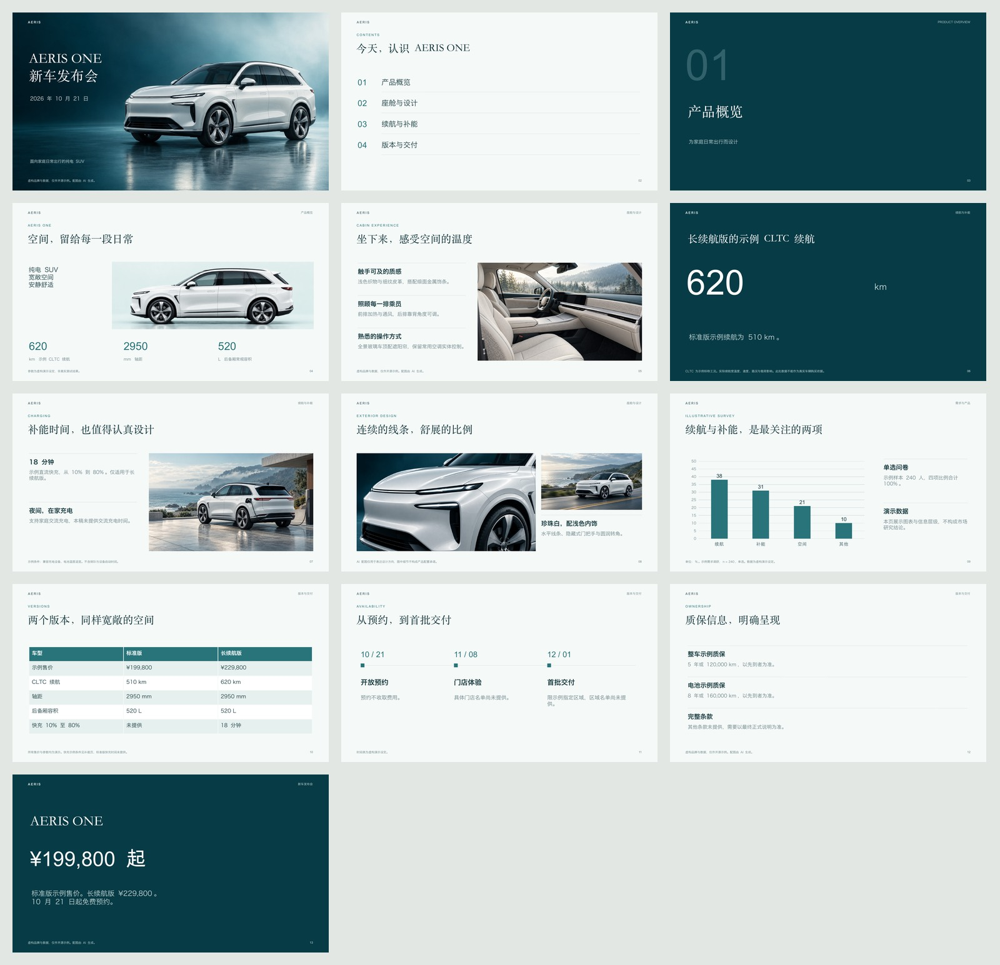

# AERIS ONE launch / 青绿产品发布会

13-slide Chinese launch deck. Fictional EV, original generated photos, native chart/table/timeline. / 13 页中文虚构车型发布稿，包含原创生成照片、原生图表、版本表与时间线。

[PowerPoint](launch.pptx) · [PDF](launch.pdf) · [Source announcement / 原始文告](inputs/announcement.md) · [Semantic plan / 语义计划](plan.json) · [Source-to-page mapping / 来源到页面](composition.json) · [Visual observations / 逐页观察](review.json)



## Reproduce / 复现

Use the repository runtime with its Node dependencies installed. Copy this example's `plan.json`, `source.json`, `inputs/` and `assets/` into a fresh workspace. Run:

安装本仓库运行依赖，将上述文件复制到新工作区后执行：

```bash
python3 scripts/compose.py compose --workspace /absolute/example-copy
python3 scripts/deck.py --workspace /absolute/example-copy init --slides 13 --mode hybrid
python3 scripts/deck.py --workspace /absolute/example-copy build
python3 scripts/deck.py --workspace /absolute/example-copy render --renderer libreoffice
python3 scripts/deck.py --workspace /absolute/example-copy verify
```

For PDF delivery, set `task.json` outputs to `["pptx","pdf","png"]` before building. Inspect every exported page and record your actual findings, then use `review` and `finalize`. Do not reuse the included review as proof of a new render.

需要 PDF 时，在构建前设置输出格式。重新导出的文件须实看全部页面并记录实际观察，不直接复制旧验收记录。详细命令见[工作流](../../references/workflow.md)。

Fonts in the plan are the actual fonts used for this macOS export. Substitute installed, properly licensed fonts on another system and recheck line breaks. Fonts are not bundled. Images are AI-generated fictional concepts. Full prompts are in [prompts.json](prompts.json); JPG files are compressed exports of the generated originals. Native text/data remain separately editable. Exact cross-application rendering is not promised.

计划记录本次实际使用的字体；其他系统应选择已安装且授权合适的字体并复查换行。图片为虚构概念，完整提示词见上，文字与数据独立可编辑，不附带字体文件。
