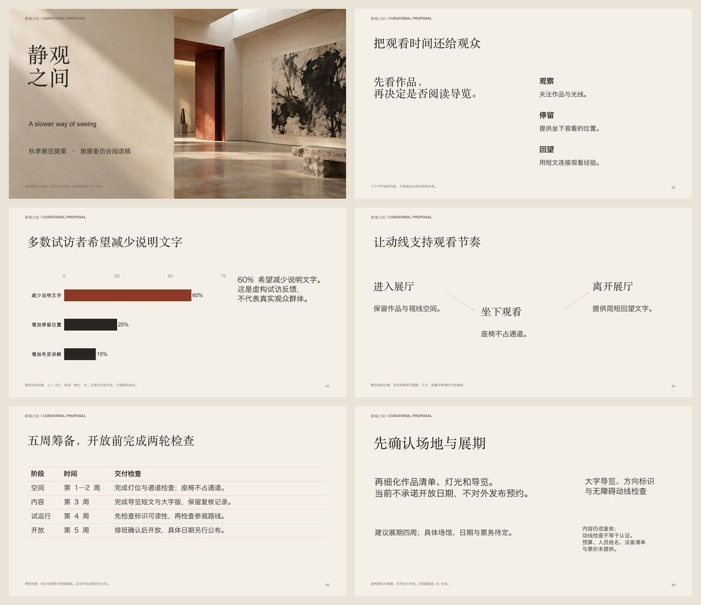

# 静观之间 / A slower way of seeing

**4.1 workflow demonstration · 6 Chinese pages / 6 页中文提案**

A fictional exhibition proposal developed through three proof comparisons, a full export critique and five verified revisions. / 虚构展览提案，包含三种页型打样、整稿批改及五项修改验证。

[PPTX](exhibition.pptx) · [PDF](exhibition.pdf) · [Source / 原文](inputs/announcement.md) · [Plan / 计划](plan.json) · [Study brief / 打样任务](design-study.json) · [Review / 逐页复查](review.json) · [Validation / 交付检查](validation.json)

[Candidate evidence / 候选证据](evidence/candidates) · [Selections and issues / 选稿与问题](evidence/index.json) · [First export / 首次导出](evidence/rounds/01/export.pptx) · [Final evidence / 最终证据](evidence/final)

## Reproduce / 复现

Copy `plan.json`, `source.json`, `inputs/` and `assets/` to a fresh workspace. Install runtime dependencies, compose and initialize six slides, then follow the [studio workflow](../../references/studio-workflow.md) with this actual audience/page task. Your new export needs its own proof/inspection records; never copy these review verdicts into a fresh state to obtain a pass.

将计划、来源和素材复制到新工作区，安装依赖、编排并初始化六页，再按打样流程完成本次真实记录。新的导出稿须重新看图，不复制旧验收来获得通过。

Fonts used on the exporting Mac: Songti SC, Hiragino Sans GB and Arial. Select installed licensed alternatives on another system and recheck shaping/wrapping. Font files are not bundled. The image is an original built-in imagegen concept, compressed to JPEG; [full prompt](prompts.json). It is not a real venue, documented artwork or architectural plan. All key text, chart/table data and connectors remain native.

本次使用上述本机字体，不附带字体文件；其他系统需更换授权字体并复查。配图为原创生成概念，不是场地实拍、纪实作品或建筑平面图。文字、数据与连接线均为原生对象。

## Reader review / 读者评审

[Anonymous packet](reader-pack/index.html) · [Blank feedback CSV](reader-pack/ratings.csv) · [Current status](reader-status.json)

**Independent human review: pending, zero decisions.** This public example is authored by the same host and already shows its candidates; it is not a strict held-out blind trial. The packet demonstrates the review tool. Use separate unreleased material and independent readers for a genuine benchmark. / **独立人工评审待完成，零条反馈。** 本公开实例不是封存盲测；严格评测需另用未公开材料和独立读者。
