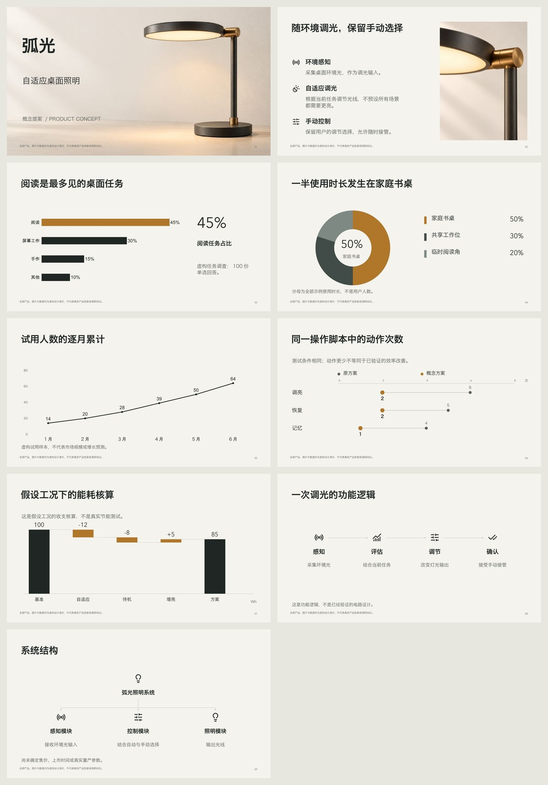

# ARC / 弧光 — automatic visual treatment

A fictional nine-page adaptive desk-light concept. The source plan contains grounded content, relationships and asset purposes, **without font names or page coordinates**. The runtime supplies supported visual recipes, installed type hierarchy and matched icons. The host generated the actual hero and detail images with built-in imagegen.

虚构的自适应台灯概念，共九页。原始计划只有内容、表达关系与配图目的，**不填写字体名称或页面坐标**；运行工具完成可支持的视觉配方、字体层级和统一图标，宿主实际生成主视觉与材质特写。

[Editable PPTX / 可编辑稿](visual-defaults.pptx) · [PDF](visual-defaults.pdf) · [Raw source / 原材料](announcement.md) · [High-level plan / 高层计划](plan.json) · [Resolved visual plan / 实际视觉计划](visual-plan.json) · [Actual image prompts / 实际生图提示词](prompts.json) · [Review / 看图复查](review.json)



| Page / 页 | Content relationship / 内容关系 | Output / 实际输出 |
|---|---|---|
| 1 | Product identity / 产品识别 | Full-bleed hero with native left-side title / 主视觉与原生标题 |
| 2 | Functional explanation / 功能解释 | Matching icons, measured text, distinct product detail / 同风格图标、功能说明、独立材质特写 |
| 3 | Ranking / 排名 | Sorted native bar chart + grounded readout / 原生条形图与有来源的大数字 |
| 4 | Share / 占比 | Native doughnut, direct labels and denominator / 原生环形图、直标与分母 |
| 5 | Time / 时间 | Native line chart in month order / 按月份的原生折线图 |
| 6 | Paired comparison / 两条件比较 | Editable dumbbell shapes, connectors and values / 可编辑哑铃图解 |
| 7 | Reconciled contributions / 加总拆解 | Editable waterfall shapes and values / 可编辑瀑布图解 |
| 8 | Sequence / 顺序 | Native arrows and semantic icons / 原生流程箭头和语义图标 |
| 9 | Hierarchy / 组成 | Native parent/child connectors and matching symbols / 原生结构分支和对应图标 |

The three native charts contain workbook data. Dumbbell/waterfall use editable shape/text diagrams; their source data is retained in the plan. Photos and icons are replaceable images, not separately editable paths. The icon library is pinned Lucide artwork, with [complete notices](../../licenses/Lucide.txt).

三张原生图表含工作簿数据；哑铃和瀑布图解由可编辑形状/文字组成，原数据保留在计划中。照片与图标为可替换图片，图标完整保留许可。

`asset-requests.json` records machine-prepared briefs; `prompts.json` records the actual tool prompts, including the hero identity reference used for the close-up. JPEG conversion only compresses the generated assets; it does not repaint them. All product concepts and numbers are fictional, with visible disclosures on every page.

配图要求与实际调用提示词分别留档，细节图以封面产品为外观参考；转换 JPEG 只进行编码压缩。所有身份与数值均为虚构，每页保留说明。

## Reproduce / 复现

Copy `plan.json`, `source.json`, `inputs/` and `assets/` into a fresh workspace. From the repository root, use installed fonts and run:

将以上文件复制到新的工作区，使用实际安装字体执行：

```bash
python3 scripts/visuals.py prepare --workspace /absolute/work
python3 scripts/compose.py compose --workspace /absolute/work
python3 scripts/deck.py --workspace /absolute/work init --slides 9 --mode hybrid
python3 scripts/deck.py --workspace /absolute/work build
python3 scripts/deck.py --workspace /absolute/work render --renderer libreoffice
```

The public rendering used macOS Hiragino Sans GB / Avenir Next. No fonts are distributed. Other environments may select different families; inspect the actual output. `tools/create-visual-example.py` recreates the fictional source and semantic plan; existing frozen inputs are preserved.

公开导出使用 macOS 已安装的 Hiragino Sans GB / Avenir Next，不附字体文件。其他环境会选择可用字体，仍需检查实际效果。

The authoring agent inspected all nine exported pages and fixed legend/subtitle spacing and hierarchy connector placement. [Delivery checks](validation.json) bind the public export hash. This is a functional visual demonstration, not a completed independent aesthetic benchmark.

制作代理已查看全部九页并修正图例、副标题和结构线间距；验证记录对应公开导出文件摘要。本例是功能演示，不冒充完成的独立审美评测。
